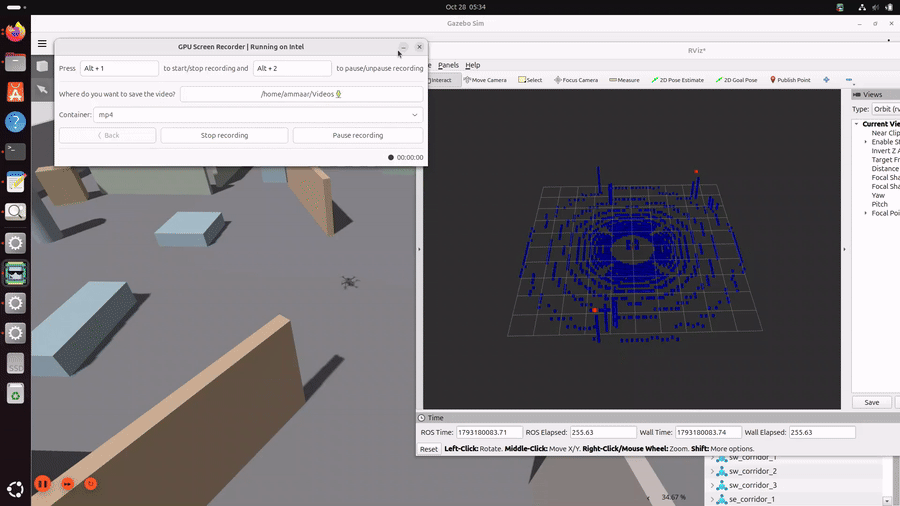
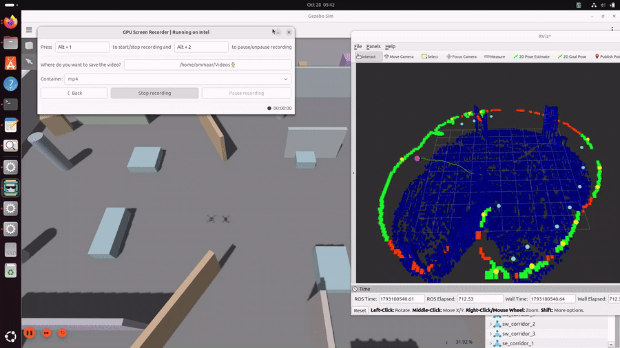
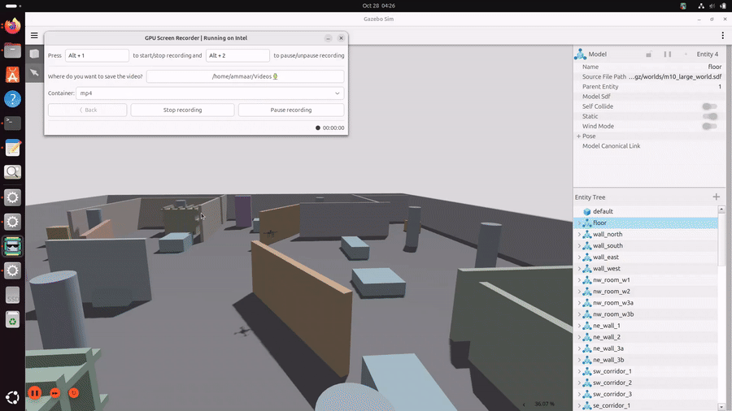
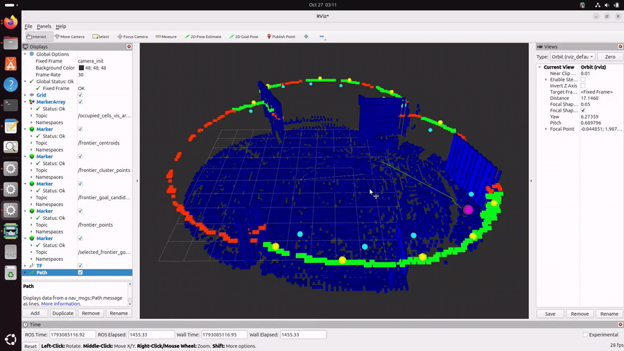
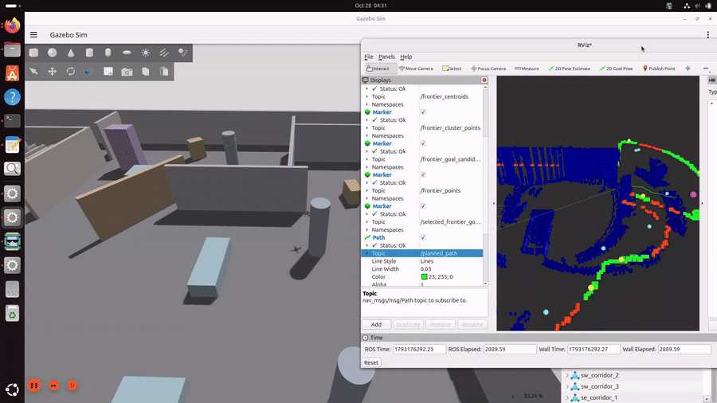

# ROS 2 + PX4 Autonomous GPS-Denied Drone

A research-oriented ROS 2 and PX4 autonomous quadcopter platform for GPS-denied 3D localization, mapping, planning, and autonomous exploration.

The project combines Point-LIO localization, PX4 EKF2 external-vision fusion, and live OctoMap mapping with a custom ROS 2 autonomy stack for frontier-based exploration, live 3D A* planning, PX4 Offboard path execution, and reactive replanning.

## Current Status

**Continuous GPS-denied autonomous 3D exploration has been demonstrated in simulation.**

The current system supports:

- PX4 SITL flight in Gazebo Harmonic
- ROS 2 and PX4 communication through Micro XRCE-DDS
- Custom `slam_quad` Gazebo/PX4 vehicle model
- 3D LiDAR, RGB-D camera, and IMU integration
- Point-LIO LiDAR-inertial localization
- PX4 EKF2 external-vision fusion
- GPS-denied position hold and autonomous flight
- Live OctoMap-based 3D occupancy mapping
- Online map expansion during flight
- Custom live frontier detection and clustering
- Safe frontier-goal generation and ranking
- Custom live 3D A* path planning
- Autonomous PX4 Offboard execution of 3D paths
- Continuous frontier-based exploration
- Local active-path obstacle monitoring
- Hold + event-driven replanning
- Demonstrated obstacle avoidance and recovery
- Safe automatic landing and disarming when recovery fails

The current autonomy stack has progressed through **M13G continuous
autonomous exploration** in simulation.

The system remains under development for smoother exploration,
fewer unnecessary replans, and increased robustness.

## Original Engineering Contributions

**Project developer: Ammaar Ahmed**

This project includes original implementation, customization,
and system-integration work.

| Component | Contribution |
|---|---|
| Offline C++ 3D A* planner | Custom OctoMap-based 3D planning, clearance constraints, and path validation |
| `frontier_detector_live` | Custom live frontier extraction, clustering, filtering, safe standoff generation, scoring, and goal selection |
| `astar_3d_live` | Custom live 3D A* planner with clearance checking, safe-start recovery, path validation, and event-driven replanning |
| `m13g_continuous_explorer` | Custom autonomous mission supervisor for takeoff, Offboard entry, 3D path execution, replanning, landing, and disarming |
| `local_path_monitor` | Custom LiDAR-based active-path blockage detection and reactive replanning trigger |
| OctoMap query node | Custom occupancy-map querying utility |
| URDF/Xacro | Project-specific drone sensor frames and TF integration |
| Gazebo environments | Custom environments for mapping, localization, planning, and exploration experiments |
| `slam_quad` | Vehicle customization, sensor integration, and PX4/Gazebo configuration |
| System integration | Integration of Point-LIO, PX4 EKF2 external vision, OctoMap, custom planning, and PX4 Offboard execution |

Point-LIO, PX4, ROS 2, Gazebo, and OctoMap are integrated
third-party systems. Original upstream copyrights and licenses
are preserved.
**[Detailed authorship and acknowledgments](AUTHORS.md)**

## Latest Demonstration

### M13 — Continuous Autonomous 3D Exploration

<p align="center">
  
  
</p>
<p align="center">
  <strong>Continuous Autonomous Exploration — Parts 1 and 2</strong>
</p>

The latest system integrates the earlier localization, mapping,
and planning milestones into a continuous GPS-denied exploration
pipeline.

The stable autonomy flow is:

    Point-LIO localization
            |
            v
    PX4 EKF2 external vision
            |
            v
       Live OctoMap
            |
            v
    Custom frontier detector
            |
            v
      Safe frontier goal
            |
            v
      Custom live 3D A*
            |
            v
    M13G exploration supervisor
            |
            v
      PX4 Offboard control
A lightweight local safety layer operates in parallel:

    LiDAR / Point-LIO cloud
            |
            v
      Local path monitor
            |
            v
      Path blockage
            |
            v
        M13G HOLD
            |
            v
    Immediate A* replan
            |
            v
     Continue exploration

The demonstrated system performs autonomous takeoff, online
map expansion, frontier selection, live 3D planning, path
execution, replanning, continued exploration, and safe landing.
**[View full M13 technical documentation](docs/M13_CONTINUOUS_AUTONOMOUS_EXPLORATION.md)**

### Frontier Selection + Live 3D A* Replanning



Frontier goals and planned paths update continuously as the
occupancy map changes.

### Online 3D Mapping



The Point-LIO / OctoMap representation expands online as the
drone enters previously unseen areas.

### Local Obstacle Avoidance + Recovery



The local path monitor can place the exploration supervisor into
HOLD, request an immediate global replan, and allow flight to
continue once a valid replacement path is available.

Obstacle avoidance and reactive replanning have been demonstrated
successfully in simulation, but remain under tuning for smoother
behavior and fewer unnecessary replans.

Previous milestone documentation:

- **[M8 — OctoMap 3D Occupancy Mapping](docs/M08_OCTOMAP_3D_MAPPING.md)**
- **[M9 — 3D A* Path Planning](docs/M09_3D_ASTAR_PLANNING.md)**
- **[M10 — Localization Robustness Testing](docs/M10_LOCALIZATION_TESTING.md)**

## System Architecture

The current autonomy pipeline is fully three-dimensional and does
not use the Nav2 controller.

    Gazebo Harmonic
      LiDAR + IMU
          |
          v
       Point-LIO
          |
          +-----------------------------+
          |                             |
          v                             v
    Localization                Registered cloud
          |                             |
          v                             v
     slam_to_px4                  Live OctoMap
          |                             |
          v                             v
    PX4 External Vision         Frontier Detector
          |                             |
          v                             v
       PX4 EKF2                 Safe Frontier Goal
                                        |
                                        v
                                  Live 3D A*
                                        |
                                        v
                                  /planned_path
                                        |
                                        v
                               M13G Explorer
                                        |
                                        v
                                PX4 Offboard
                                        |
                                        v
                                    slam_quad
Local safety and reactive replanning operate alongside the global
planner:

    Active 3D path + LiDAR cloud
               |
               v
        Local Path Monitor
               |
               v
      /local_path_blocked
               |
               v
           M13G HOLD
               |
               v
      /planner_replan_now
               |
               v
          Live 3D A*
               |
               v
        Replacement path

PX4 remains responsible for low-level flight stabilization while
the project-specific ROS 2 nodes implement exploration, planning,
mission supervision, and replanning behavior.

## Coordinate Conversion

Point-LIO publishes odometry using the ROS ENU coordinate convention, while PX4 uses NED.

The position conversion used by the project is:

```text
PX4 X = ROS Y
PX4 Y = ROS X
PX4 Z = -ROS Z
```

## Software Stack

- Ubuntu Linux
- ROS 2 Jazzy
- PX4 Autopilot SITL
- Gazebo Harmonic
- Micro XRCE-DDS Agent
- Point-LIO
- OctoMap / octomap_server
- Custom C++ 3D A* planner
- RViz
- Python
- C++
- QGroundControl

## Repository Structure

ros2-px4-autonomous-drone/
    |
    |-- ros2_ws/
    |   `-- src/
    |       |-- drone_offboard_control/
    |       |   `-- drone_offboard_control/
    |       |       |-- m13g_continuous_explorer.py
    |       |       `-- local_path_monitor.py
    |       |
    |       |-- drone_3d_planner/
    |       |   `-- src/
    |       |       |-- astar_3d.cpp
    |       |       |-- astar_3d_live.cpp
    |       |       |-- frontier_detector_live.cpp
    |       |       `-- octomap_query.cpp
    |       |
    |       `-- slam_quad_description/
    |
    |-- px4/
    |   `-- slam_quad/
    |
    |-- point_lio/
    |   |-- config/
    |   |-- launch/
    |   `-- patches/
    |
    |-- gazebo/
    |   `-- worlds/
    |
    |-- octomap/
    |   `-- maps/
    |
    |-- docs/
    |   |-- M08_OCTOMAP_3D_MAPPING.md
    |   |-- M09_3D_ASTAR_PLANNING.md
    |   |-- M10_LOCALIZATION_TESTING.md
    |   `-- M13_CONTINUOUS_AUTONOMOUS_EXPLORATION.md
    |
    |-- images/
    |
    |-- media/
    |   `-- m13/
    |       |-- full_exploration_1.gif
    |       |-- full_exploration_2.gif
    |       |-- map_growth.gif
    |       |-- frontier_replanning.gif
    |       `-- obstacle_avoidance.gif
    |
    |-- AUTHORS.md
    `-- README.md

The repository contains project-specific ROS 2 packages,
simulation environments, configuration files, validation media,
technical documentation, and custom autonomy implementations.

## Custom ROS 2 Nodes

The `drone_offboard_control` package contains:

- `offboard_control` — basic PX4 Offboard mission
- `mapping_mission` — autonomous flight mission for mapping tests
- `slam_to_px4` — Point-LIO to PX4 external-vision bridge
- `lidar_time_converter` — LiDAR timestamp conversion for Point-LIO
- `gps_denied_waypoint` — GPS-denied waypoint controller
- `m13g_continuous_explorer` — continuous autonomous exploration supervisor
- `local_path_monitor` — active-path LiDAR blockage monitor and replanning trigger

The `drone_3d_planner` package contains:
- `astar_3d` — offline three-dimensional A* planner
- `octomap_query` — OctoMap occupancy-query utility
- `frontier_detector_live` — live frontier detection, clustering, safe-goal generation, and ranking
- `astar_3d_live` — live OctoMap-based 3D A* planner with event-driven replanning

The current portfolio copies of both packages were independently
build-tested with ROS 2 Jazzy and `colcon`.

## Project Milestones

- **M0** — PX4 SITL + Gazebo flight: complete
- **M1** — ROS 2 and PX4 communication: complete
- **M2** — Autonomous Offboard control: complete
- **M3** — Custom `slam_quad` vehicle: complete
- **M4** — Sensor and TF integration: complete
- **M5–M6** — Localization preparation and integration: complete
- **M7** — GPS-denied localization and autonomous navigation: complete
- **M8** — [3D occupancy mapping](docs/M08_OCTOMAP_3D_MAPPING.md): complete
- **M9** — [offline 3D A* path planning](docs/M09_3D_ASTAR_PLANNING.md): complete
- **M10** — [localization robustness and obstacle-avoidance development](docs/M10_LOCALIZATION_TESTING.md): simulation validation completed; robustness tuning continues
- **M11** — Autonomous execution of planned 3D paths: complete
- **M12** — Live frontier-based exploration: complete
- **M13** — [continuous autonomous 3D exploration](docs/M13_CONTINUOUS_AUTONOMOUS_EXPLORATION.md): demonstrated in simulation
- **M14** — Optional semantic mapping: planned
M13 sub-milestones currently include:

- **M13A** — Live OctoMap: PASS
- **M13B** — Live frontier detection: PASS
- **M13C** — Clustering + safe frontier selection: PASS
- **M13D** — Live 3D A* replanning: PASS
- **M13E** — Autonomous execution of A* paths: PASS
- **M13F** — Repeated frontier exploration: PASS
- **M13G** — Continuous autonomous exploration: demonstrated

## Third-Party Components

This repository contains project-specific configuration and integration work for several open-source projects.

External dependencies include:

- PX4 Autopilot
- ROS 2
- Gazebo
- Micro XRCE-DDS
- Point-LIO
- OctoMap

Original third-party model assets retain their respective licenses and attribution. The `slam_quad` model directory includes the original BSD 3-Clause license associated with the upstream model assets.

## Development Status

The project has progressed from GPS-denied localization and
mapping to **continuous autonomous 3D exploration in simulation**.
The current demonstrated stack combines:

- Point-LIO LiDAR-inertial localization
- PX4 EKF2 external-vision fusion
- live OctoMap generation
- custom frontier detection and safe-goal selection
- custom live 3D A* planning
- continuous PX4 Offboard path execution
- local LiDAR-based path monitoring
- event-driven replanning
- safe automatic landing when recovery fails
The system has visibly demonstrated online map growth, path
following, obstacle detection, replanning, avoidance / recovery,
and continued autonomous exploration.

Current work focuses on robustness rather than adding a new
high-level capability: smoother exploration, fewer unnecessary
replans, and validation in increasingly challenging scenarios.

The current exploration results are simulation demonstrations and
should not be interpreted as production-ready dynamic obstacle
avoidance or complete real-world validation.

